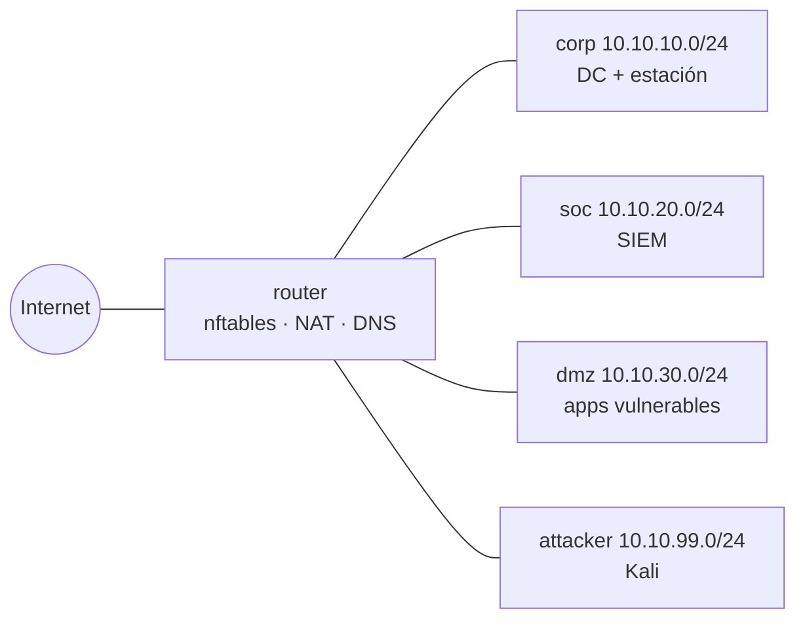

# Homelab de ciberseguridad

   

> **TL;DR:** un laboratorio reproducible con un solo comando. Tiene 4 segmentos de red separados por un router-firewall con nftables, DNS propio y tests automáticos que verifican la política de red. Sobre esta plataforma corren todos los proyectos ofensivos y defensivos del portfolio.

## 1. Problema

Para practicar y probar herramientas, hace falta un entorno realista que se pueda **romper y reconstruir** sin miedo. 

## 2. Enfoque

- **Infraestructura como código:** `lab.yml` es la fuente de verdad y el `Vagrantfile` la interpreta.
- **Segmentación:** cada red refleja una zona real (usuarios, SOC, DMZ, atacante). Ver [docs/red.md](docs/red.md).
- **Perfiles de ejecución:** en la mayoría de dispositivos domésticos, no alcanza la ram para todas las máquinas a la vez (8/16 GB), así que se levanta sólo el o los perfiles que pide cada ejercicio.
- **Verificable:** las políticas de firewall se prueban con conexiones reales.
- Se deja documentado por escrito las decisiones tomadas y sus porqués en [docs/decisiones.md](docs/decisiones.md).

### Proyectos de esta rama

| # | Proyecto | Estado |
|---|---|---|
| 0.1 | Red segmentada y router-firewall | 🚧 |
| 0.2 | Dominio Active Directory | 🔜 |
| 0.3 | Stack de monitoreo (Wazuh) | 🔜 |
| 0.4 | Zona atacante y objetivos vulnerables | 🔜 |
| 0.5 | Plataforma: golden images, snapshots y CI | 🔜 |

## 3. Arquitectura



| Máquina | IP | Rol | Proyecto |
|---|---|---|---|
| router | .1 en cada segmento | Gateway, firewall, NAT, DNS | 0.1 |
| soc-siem | 10.10.20.10 | SIEM (Wazuh en 0.3) | 0.1 |
| dmz-web | 10.10.30.10 | Host de apps vulnerables | 0.1 |
| corp-dc | 10.10.10.10 | Controlador de dominio `lab.local` | 0.2 |
| corp-ws01 | 10.10.10.21 | Estación Windows | 0.2 |
| attacker-kali | 10.10.99.10 | Atacante | 0.4 |

```text
homelab/
├── lab.yml                  # Redes, máquinas y perfiles
├── Vagrantfile              # Lee lab.yml
├── provision/
│   ├── router.sh            # Forwarding, nftables, NAT, dnsmasq
│   └── linux-client.sh      # Gateway/DNS hacia el router + utilidad lab-check
├── scripts/Setup-Host.ps1   # Prepara Windows (VirtualBox, Vagrant, dónde guardar las VMs)
├── tests/Test-Network.ps1   # Verifica la política de red
└── docs/                    # red.md, decisiones.md
```

## 4. Cómo reproducirlo

**Requisitos:** Windows 10/11 con virtualización activada, 16 GB de RAM (8 GB alcanzan para el perfil base), ~20 GB libres para Linux y ~60 GB cuando se sumen las VMs Windows.

```powershell
# 1. Preparar el host (una sola vez). Abrí una terminal nueva después.
#    Guarda las VMs en el disco con más espacio libre; para elegir otro lugar: -LabRoot E:\Lab
.\scripts\Setup-Host.ps1

# 2. Levantar el perfil base: router + soc-siem + dmz-web
vagrant up

# 3. Verificar la política de red
.\tests\Test-Network.ps1

# 4. Verificar que la configuración sobrevive un reinicio
vagrant reload
.\tests\Test-Network.ps1
```

Otros comandos útiles:

```powershell
vagrant status                          # Estado de las VMs
vagrant ssh router -c "sudo nft list ruleset"
vagrant ssh router -c "sudo journalctl -k --grep LAB- -n 20"   # Drops del firewall
vagrant halt                            # Apagar
vagrant destroy -f                      # Borrar todo (se reconstruye con vagrant up)
$env:LAB_PROFILE = "blue"; vagrant up   # Otro perfil (cuando existan 0.2 y 0.3)
```

**Resultado esperado:** `Test-Network.ps1` termina con `Todos los tests pasaron (9).`

## 5. Resultados

| Métrica | Valor |
|---|---|
| Tiempo de `vagrant up` desde cero (perfil base) | _por medir_ |
| Tests de política de red | _x / 9_ |
| RAM usada (perfil base) | ~2.8 GB |

## 6. Lecciones aprendidas

- _Completar a medida que avance: qué falló, cómo se resolvió, qué haría distinto._

## 7. Código de terceros y créditos

Ver [THIRD_PARTY.md](THIRD_PARTY.md).

## Licencia

Código: MIT · Documentación: CC BY 4.0
