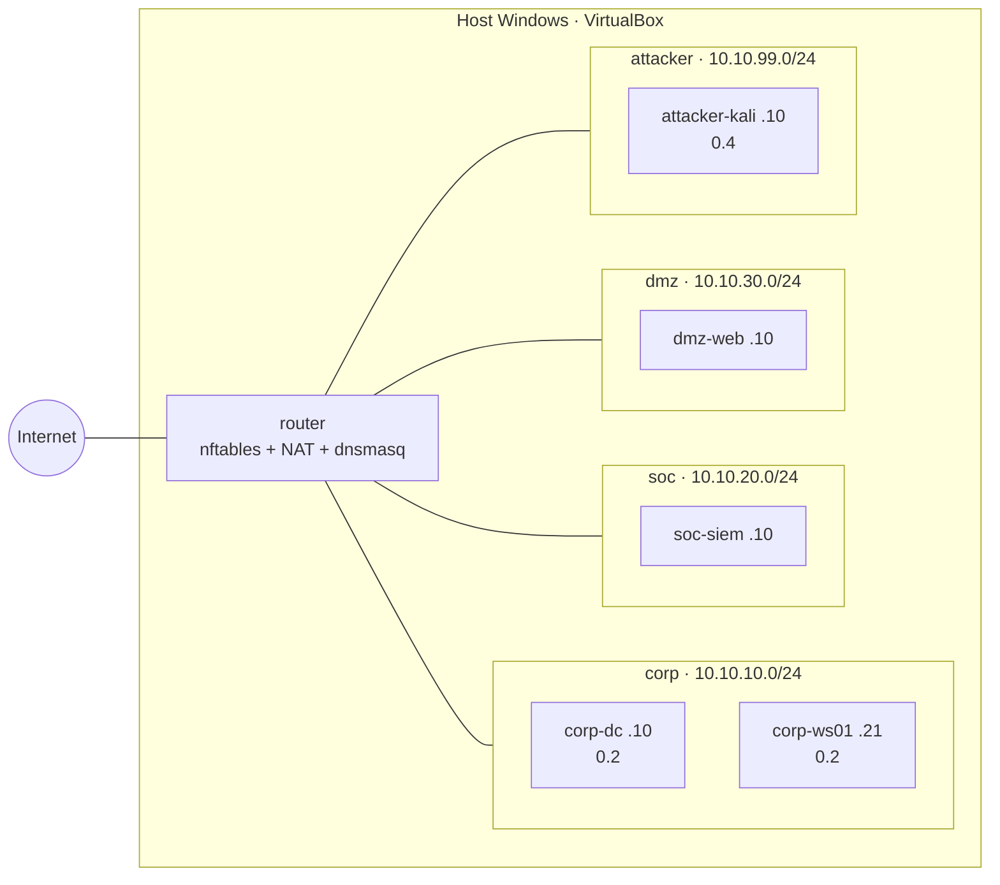

# Diseño de red

## Topología

| Segmento | Red | Gateway | Red interna de VirtualBox | Propósito |
|---|---|---|---|---|
| corp | 10.10.10.0/24 | .1 | `cyberlab-corp` | Usuarios y Active Directory |
| soc | 10.10.20.0/24 | .1 | `cyberlab-soc` | SIEM y herramientas de defensa |
| dmz | 10.10.30.0/24 | .1 | `cyberlab-dmz` | Servicios expuestos y apps vulnerables |
| attacker | 10.10.99.0/24 | .1 | `cyberlab-attacker` | Máquina atacante |

Cada VM tiene además un **adaptador NAT de Vagrant** (10.0.2.15). Se usa sólo para `vagrant ssh`: la ruta por defecto y el DNS se mueven al router (`provision/linux-client.sh`).

## Política de firewall (forward)

Política por defecto: **drop + log** (`LAB-FWD-DROP`).

| Origen ↓ / Destino → | corp | soc | dmz | attacker | Internet |
|---|---|---|---|---|---|
| **corp** | — | Sólo 1514-1515/tcp al SIEM | 80, 443, 3000, 8080 | ❌ | ✅ |
| **soc** | ✅ | — | ✅ | ✅ | ✅ |
| **dmz** | ❌ | Sólo 1514-1515/tcp al SIEM | — | ❌ | ✅ |
| **attacker** | ✅ (alcance AD) | ❌ | ✅ | — | ✅ |

**Hacia el router (input):** DNS desde todos los segmentos, SSH sólo desde el SOC y por el adaptador NAT, ICMP permitido. El resto se descarta con log (`LAB-IN-DROP`).

## Por qué así

- **El atacante no ve al SOC.** Así se evita que se "haga trampa" apagando la defensa, como pasaría en una red real bien segmentada.
- **La DMZ no puede iniciar conexiones a corp.** Si comprometés un servidor de la DMZ, pivotear hacia corp requiere otra técnica. Eso es material para detección.
- **Los logs de drops y las consultas DNS** quedan en el journal del router. En 0.3 se envían al SIEM.

## Verificación

`tests/Test-Network.ps1` comprueba la tabla anterior con conexiones reales. Distingue tres resultados:
- `OPEN`: hay un servicio y el firewall dejó pasar.
- `CLOSED`: el firewall dejó pasar, pero no hay servicio (*connection refused*).
- `FILTERED`: el firewall descartó el paquete (timeout).
